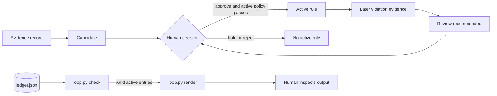

# Architecture

Palinode Loop separates **evidence**, **policy**, and **execution**. A person records and evaluates a candidate, approves or rejects it, and edits the ledger. The CLI checks that file and renders active rules; it does not manage lifecycle transitions or enforce guidance in an agent host.

The diagram describes intended human practice and CLI data flow. A human edits `ledger.json` between decisions; no arrow is an automatic state transition. See the synthetic [`examples/ledger.json`](examples/ledger.json).

## Schema and policy

The top-level object requires `schema_version: 1` and an `entries` array. Each entry requires:

| Field | Shape and purpose |
|---|---|
| `id` | Unique ASCII ID matching `[A-Za-z][A-Za-z0-9_-]{0,63}`. |
| `state` | `candidate`, `active`, `dormant`, or `rejected`. |
| `trigger`, `action`, `scope` | Single-line strings that form the conditional rule and bound where it applies. |
| `evidence` | Array of records with `session`, ISO date, `source`, `quote`, and `excerpt`. At least one distinct session is required for eligibility; an empty array is valid for an ineligible candidate. The quote must occur in the supplied excerpt. |
| `admission` | Boolean answers for `own_mistake`, `recurring`, `preventable`, and `covered_by_rule`. |
| `approval` (optional) | `decision`, `by`, and date. `decision` must equal `approve` for an active entry. |
| `violations` (optional) | Evidence records in the same format as `evidence`. |

An entry is eligible when it has evidence from at least one distinct session, all three positive admission answers, and `covered_by_rule: false`. An active entry must additionally have two distinct evidence sessions, an approval attestation, and a generated rule of no more than 30 words. The session minimum and word cap are fixed policy heuristics, not empirically selected thresholds. The ledger does not authenticate the approver.

Two distinct violation-session labels on an active rule make `check` recommend review. It does not choose whether to revise, retain, or retire the rule. Unrecorded events cannot affect the result.

## Code path

1. `load(path)` reads at most 1 MiB, decodes UTF-8, and parses JSON while rejecting duplicate object keys and non-finite constants.
2. `validate(data)` checks the schema, allowed fields and states, unique safe IDs, scalar types, dates, admission, approval, and active-rule constraints.
3. `evidence(items, path)` checks record fields and quote-substring presence, and returns distinct trimmed session labels. It does not inspect a source or interpret a quote.
4. `main(argv)` implements `check` and `render`. `check` reports state and eligibility; for active entries with the violation threshold it adds a review recommendation. `render` prints only active rules as `When <trigger>, <action>. [Scope: <scope>]`.

Input strings reject Unicode control, format, surrogate, and line/paragraph separator characters. Unknown fields fail closed. Errors return nonzero status; the CLI writes no files.

## Trust boundaries

| The CLI checks | The CLI does not establish |
|---|---|
| Ledger shape, allowed values, distinct declared session labels, and quote presence in supplied excerpts. | That a source or session is genuine, that a quote supports a rule, or that all relevant events were recorded. |
| An `approve` value exists for an active entry. | Approver identity, human review quality, or reviewer independence. Approval is an unsigned ledger attestation. |
| A rule meets configured local policy. | That the rule is safe, wise, current, or effective. |

The tool uses Python's standard library and makes no network or model calls. It does not capture conversations, create or promote candidates, change ledger states, modify host settings, or enforce rules. Review rendered rules before manually copying them into host instructions. The walkthrough also represents a decision; it never edits the ledger.

## Source map

- [`loop.py`](loop.py) — implementation of `load`, `validate`, `evidence`, and `main`.
- [`tests/test_loop.py`](tests/test_loop.py) — offline tests using fabricated records.
- [`docs/index.html`](docs/index.html) — interactive six-stage explanation and linked studies.
- [`docs/architecture.svg`](docs/architecture.svg) — portable diagram.
- [`docs/evidence.md`](docs/evidence.md) — published research comparisons and limits.
