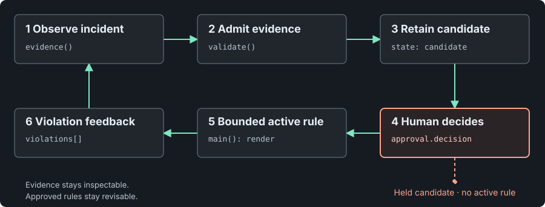

# Palinode Loop

**Make the next mistake harder to repeat.**

> Human-governed feedback harness: turn documented agent failures into reviewed, scoped rules and inspect when they fail again.

Palinode Loop makes a feedback path concrete: evidence informs a candidate, a person approves or rejects a conditional rule, a local tool checks the ledger and renders active rules, and later violations bring the rule back for review. Its architectural contribution is the explicit lifecycle joining evidence, human policy decisions and repeat checks.

The name refers to a [*palinode*](https://www.etymonline.com/word/palinode), a poem or statement that revises an earlier position. The project treats revision as a practical form of corrigibility: keep the grounds for a decision visible, then let a person decide what should change. It does not change model weights or learn autonomously.



[Explore the interactive tour](docs/index.html) · [Read the architecture](ARCHITECTURE.md) · [Review the security notes](SECURITY.md)

## Why this workflow

Agent workflows can benefit from context drawn from execution feedback and prior events. Published studies report gains in specific settings: ACE reports **57.2 vs 42.4** across four AppWorld metrics for its evaluated configuration; LongMemEval-V2 reports AgentRunbook-C at **74.9% vs 69.9%** on the small tier and **70.1% vs 68.7%** on medium; DreamBench-SWE's v2.1 audit reports **82/180** passes for a deterministic event-memory baseline and **21/180** for no external memory. These are results for the studied systems and tasks, not Palinode Loop. The [evidence notes](docs/evidence.md) give the comparisons, methods, and limits.

Palinode Loop turns that motivation into a portable reference implementation. Evidence stays attached to a candidate; approval stays an explicit human decision; only active, approved rules are rendered for deliberate use. A recurring violation is visible as a reason to revisit a rule. The two-session minimum and 30-word cap are policy heuristics, not research-derived thresholds.

## Try it locally

Requires **Python 3.10+** and its standard library. From this directory:

```sh
python3 loop.py check examples/ledger.json
python3 loop.py render examples/ledger.json
python3 -m unittest discover -s tests -v
```

`check` validates the supplied ledger. `render` prints active conditional rules with their declared scope. Both commands read a named local file, make no network or model calls, and do not modify the ledger or host settings. The example and tests use fabricated records.

## Boundaries

This is a local checker and renderer, not a conversation collector, retrieval service, approval system, or host enforcement layer. A quote matching a supplied excerpt does not establish source authenticity or semantic support; approval fields do not authenticate a reviewer. A passing check establishes structural consistency under the implemented rules, not truth, completeness, reviewer independence, or improved agent reliability.

## Source map

- `loop.py` — version 1 ledger checker and active-rule renderer.
- `examples/ledger.json` — fabricated active rule and candidate.
- `tests/test_loop.py` — offline structural and input-boundary checks.
- `docs/index.html` — offline interactive tour.
- `docs/architecture.svg` — static diagram.
- `docs/evidence.md` — cited studies and limits.

## Origin and release

Palinode Loop is an original portable reference implementation developed with AI assistance from a previously investigated lessons workflow. This package contains no private records or personal examples. It is version **0.1.0**, prepared for review; publication and adoption are not implied.

The proposed project licence is MIT; see `LICENSE`. The included font is under SIL Open Font License 1.1; see `THIRD_PARTY.md`.
